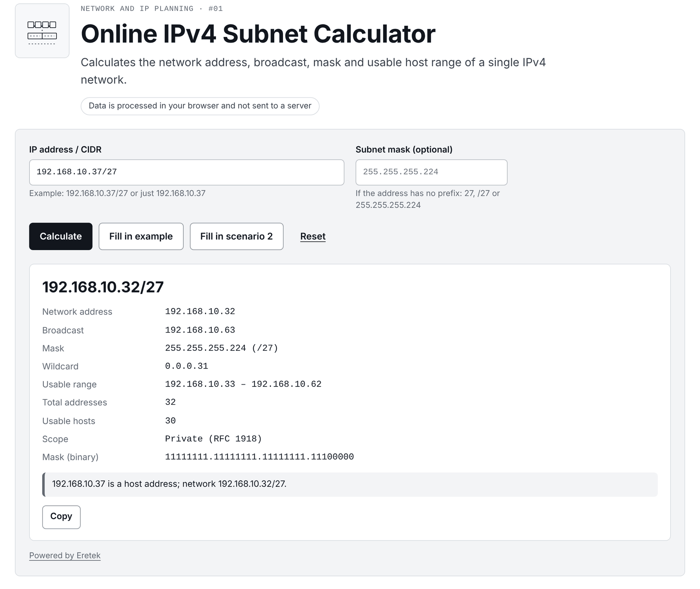

# IPv4 Subnet Calculator

Calculate network address, broadcast, wildcard, usable range and host count from an IP address with CIDR prefix or subnet mask. Handles /31 and /32 correctly.

## Try it live

- [Türkçe](https://network.eretek.com/araclar/ipv4-subnet-hesaplayici)
- [English](https://network.eretek.com/en/tools/ipv4-subnet-calculator)
- [Deutsch](https://network.eretek.com/de/werkzeuge/ipv4-subnetzrechner)



## What it does

Calculates the network address, broadcast, mask and usable host range of a single IPv4 network.

When you address an interface, write an ACL or firewall object, or check how many devices fit in a network, you need the same answers: which network does this IP belong to, what is the broadcast, which are the first and last usable addresses? This tool solves **one network**. To split a parent block into several VLANs, use the VLAN and VLSM IP Planner.

## Where it helps

Use the wildcard value in ACL and OSPF statements, and the mask or prefix in interface configuration.

If you entered a host address, the tool also shows its network. Assigning the network or broadcast address to an interface makes the device reject the configuration or behave incorrectly.

## How to use it

1. Enter the IP address with its CIDR prefix (`192.168.10.37/27`) or leave out the prefix and enter the mask in the second field.
2. The mask field accepts `27`, `/27` or `255.255.255.224`.
3. Press Calculate; you can copy the result table.

### Fields

| Field | Description |
|---|---|
| IP address / CIDR | Example: 192.168.10.37/27 or just 192.168.10.37 |
| Subnet mask (optional) | If the address has no prefix: 27, /27 or 255.255.255.224 |

## Example input

Press **Fill in example** in the tool to load this input.

| Input | Value |
|---|---|
| IP address / CIDR | `192.168.10.37/27` |

**Expected result:** Network 192.168.10.32, broadcast 192.168.10.63, mask 255.255.255.224, wildcard 0.0.0.31, usable range .33–.62, 30 hosts.

## Method and assumptions

Address and mask are converted to 32-bit integers. The network is `IP AND mask`, the broadcast is `network OR wildcard`. The wildcard is the bitwise inverse of the mask.

The total is 2<sup>32−prefix</sup> addresses. For /30 and larger networks the network and broadcast addresses are subtracted. For /31, RFC 3021 makes both addresses usable and there is no broadcast. /32 is a single host route.

A mask with non-contiguous bits (e.g. 255.255.0.255) is rejected. Octets with leading zeros (010) are rejected because of the octal ambiguity.

## Limits and common mistakes

- IPv4 only. For IPv6 use the IPv6 Prefix and Address Normalizer.
- Classful (A/B/C) addressing is not shown; routing today is classless.
- The private/public scope label comes from the IANA special-purpose blocks; it does not check whether the address is actually routed.

## Run it locally

The tool is plain HTML, CSS and JavaScript with no build step and no dependencies.

```bash
git clone https://github.com/eretek/ipv4-subnet-calculator.git
cd ipv4-subnet-calculator
node scripts/serve.js        # or: python3 -m http.server 8080
```

Open <http://127.0.0.1:8080/>. Add `?lang=tr` or `?lang=de` for Turkish or German; without it the page follows the browser language and falls back to English. You can also open `index.html` directly from disk.

Run the tests (Node.js 18 or later):

```bash
node test/run.js    # or: npm test
```

The tests run the tool's own fixtures and the worked examples in all three languages without a browser.

## How it works

All processing happens in your browser. The tool makes no network requests, uses no cookies or browser storage, and does not upload files you select.

No server-side component is needed. The version on the Eretek website renders the same page through a private WordPress plugin; that plugin only produces the page markup and is not part of this repository.

| Path | Purpose |
|---|---|
| `index.html` | Page shell |
| `src/app.js` | Builds the page in Turkish, English or German from `src/data.js` |
| `src/data.js` | Field definitions, examples and all texts in three languages |
| `src/core.js` | Shared runtime: validation, number formats, result rendering, CSV/ICS export |
| `src/tool.js` | The calculation or analysis for this tool |
| `docs/screenshot.png` | Screenshot used in this README |
| `src/lib/ip.js` | IPv4/IPv6 library (BigInt) |
| `src/tools.css`, `src/page.css` | Styles |
| `test/run.js`, `test/cases.json` | Headless tests |

## License and attribution

This tool is released under the [Eretek Website Attribution License](LICENSE). You may use, modify and redistribute it, including commercially. If you make it available on a website or web application, show a visible, clickable credit linking to https://eretek.com/ on every page where the tool is available, for example:

```html
<a href="https://eretek.com/">Powered by Eretek</a>
```

You may add `rel="nofollow"` to the link. Keep the copyright notice and license text in copies and redistributions.
